# Manual da Secretária — EasyEye

Guia completo de utilização do sistema para o perfil **Secretária**, passo a passo com telas reais.
Cobre todas as áreas que o perfil acessa: agenda (com séries de sessões), mural de recados, fila de
espera, pacientes, retornos e convite de retorno por WhatsApp, importação, médicos (escala e
bloqueios), Gerenciador de exames, assistente de IA e conta.

> As capturas deste manual são geradas automaticamente a partir do sistema real
> (`e2e/cypress/e2e/docs/secretary-manual.cy.js`). Para atualizá-las após mudanças de tela:
> `cd e2e && npx cypress run --browser chrome --config excludeSpecPattern=__none__ --spec cypress/e2e/docs/secretary-manual.cy.js`
> e copie as imagens de `e2e/cypress/screenshots/secretary-manual.cy.js/` para `docs/manual-secretaria/img/`.
> As telas de aviso de cobrança (imagens 33 e 34) vêm de `e2e/cypress/e2e/docs/billing-manual.cy.js`
> (cria e remove sozinho clínicas de demonstração): copie
> `e2e/cypress/screenshots/billing-manual.cy.js/sec/` para `docs/manual-secretaria/img/`.

---

## Sumário

1. [Acesso ao sistema](#1-acesso-ao-sistema)
2. [Agenda](#2-agenda)
3. [Novo agendamento](#3-novo-agendamento)
4. [Situações do atendimento e cancelamento](#4-situações-do-atendimento-e-cancelamento)
5. [Mural de recados](#5-mural-de-recados)
6. [Fila de espera](#6-fila-de-espera)
7. [Pacientes](#7-pacientes)
8. [Importação de pacientes por planilha](#8-importação-de-pacientes-por-planilha)
9. [Médicos: consulta, escala e bloqueios](#9-médicos-consulta-escala-e-bloqueios)
10. [Gerenciador de exames](#10-gerenciador-de-exames)
11. [Portal do Paciente: convite e compartilhamento de exame](#11-portal-do-paciente-convite-e-compartilhamento-de-exame)
12. [Retornos: quem precisa voltar à clínica](#12-retornos-quem-precisa-voltar-à-clínica)
13. [Convite de retorno por WhatsApp](#13-convite-de-retorno-por-whatsapp)
14. [Assistente de IA (consumo)](#14-assistente-de-ia-consumo)
15. [Avisos sobre a assinatura da clínica](#15-avisos-sobre-a-assinatura-da-clínica)
16. [Minha conta e saída do sistema](#16-minha-conta-e-saída-do-sistema)
17. [O que o perfil de secretária NÃO acessa](#17-o-que-o-perfil-de-secretária-não-acessa)

---

## 1. Acesso ao sistema

1. Acesse o endereço do painel da clínica e informe **e-mail** e **senha**.
2. Se a clínica exigir, conclua a verificação em duas etapas (código do aplicativo autenticador).
3. Após o login você chega ao **Painel de controle**, com os indicadores do dia:

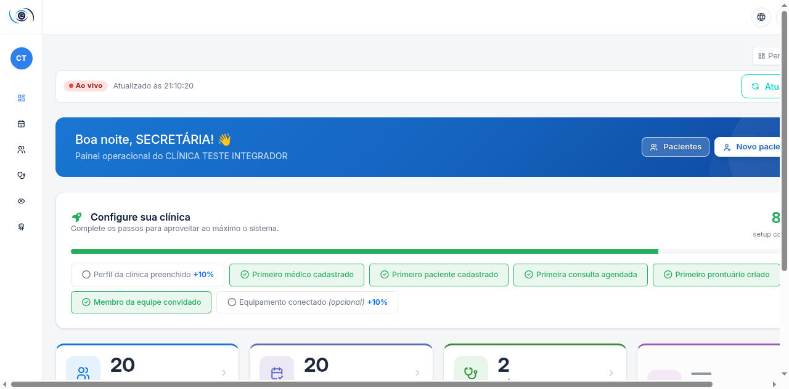

O **menu lateral** (passe o mouse sobre a barra à esquerda para expandir) mostra exatamente as
áreas do seu perfil:

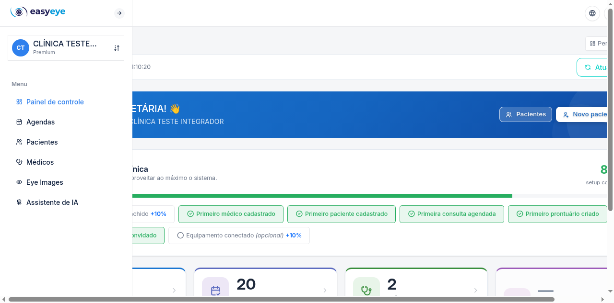

| Item do menu | O que faz |
|---|---|
| Painel de controle | Indicadores do dia e atalhos |
| Agendas | Agenda da clínica (o centro do seu trabalho) |
| Retornos | Pacientes que precisam voltar à clínica (aparece se o plano incluir o recurso — [seção 12](#12-retornos-quem-precisa-voltar-à-clínica)) |
| Pacientes | Cadastro completo de pacientes |
| Médicos | Consulta ao corpo clínico, escala e bloqueios |
| Gerenciador de exames | Exames de imagem dos pacientes |
| Assistente de IA | Acompanhamento do uso de IA da clínica |

---

## 2. Agenda

Clique em **Agendas** no menu. A tela abre no dia atual, em visão de lista:

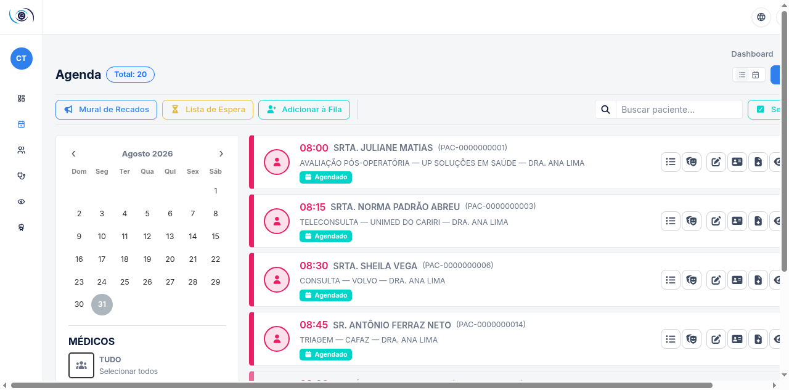

Elementos da tela:

- **Calendário lateral** — clique num dia para trocar a data; as setas mudam o mês.
- **Filtro por médico** — na coluna MÉDICOS, selecione um profissional ou "TUDO".
- **Cards de atendimento** — cada card mostra horário, paciente, código, tipo de consulta,
  convênio, médico e a **situação** (etiqueta colorida: Agendado, Confirmado, Atendido…).
- Botões do topo: **Mural de Recados**, **Lista de Espera**, **Adicionar à Fila**, busca e **Novo**.

### Visão de calendário

Use os botões no canto superior direito para alternar entre **lista** e **calendário**:

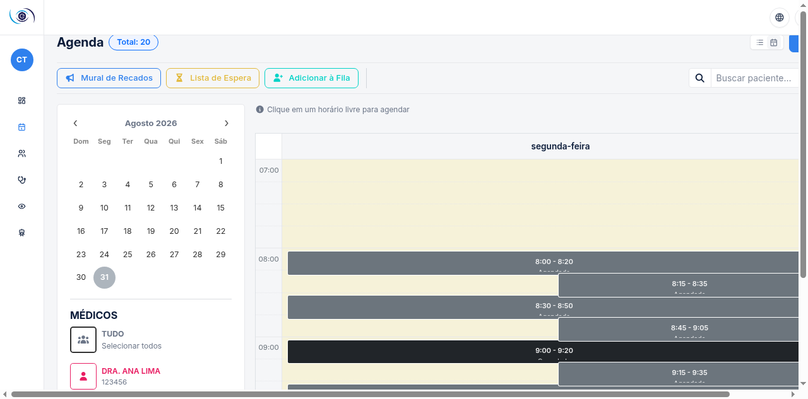

### Buscar um paciente na agenda

Digite parte do nome no campo **Buscar paciente...** — a lista filtra sozinha:

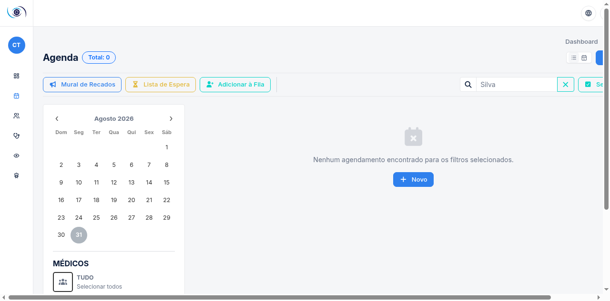

---

## 3. Novo agendamento

1. Na Agenda, clique no botão **Novo** (canto superior direito).
2. O painel de novo agendamento abre:

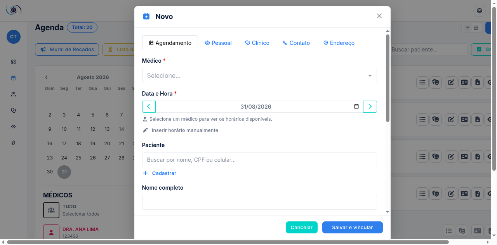

3. Selecione o **médico**. Os **horários disponíveis** do dia aparecem automaticamente,
   respeitando a escala do profissional e o intervalo entre consultas:

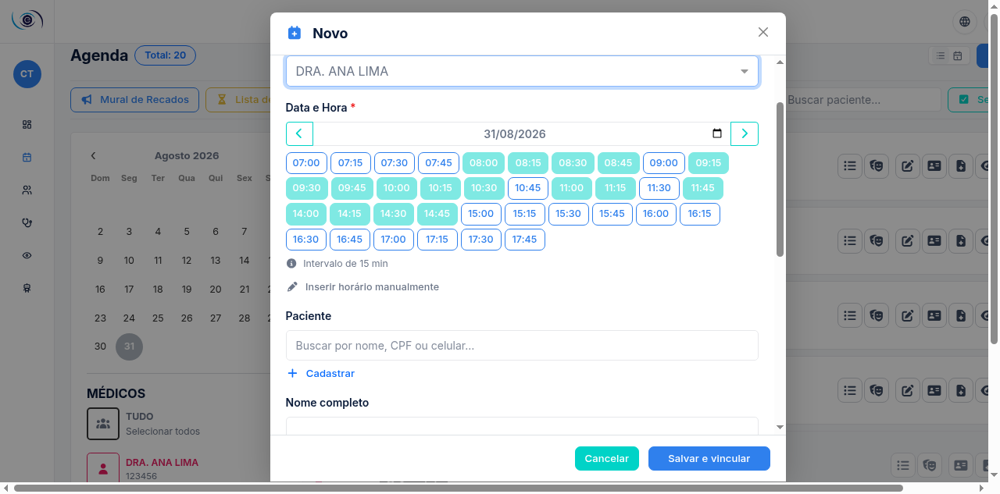

4. Escolha a **data** (setas ou campo de data) e clique no **horário** desejado.
   Horários já ocupados aparecem desabilitados. Se precisar de um horário fora da grade,
   use **Inserir horário manualmente**.
5. No campo **Paciente**, busque por nome, CPF ou celular.
   - Paciente ainda não cadastrado? Clique em **+ Cadastrar** e preencha o nome completo —
     o cadastro rápido cria o paciente junto com o agendamento.
6. Informe o tipo de consulta e o convênio, se solicitados.
7. Clique em **Salvar e vincular**. O card aparece na agenda na data escolhida.

### Série de sessões (repetir o agendamento)

Para tratamentos seriados (injeção intravítrea, campimetria seriada, ortóptica…), crie todas as
sessões de uma vez, no fim do painel de novo agendamento:

1. Marque **Repetir (série de sessões)**.
2. Em **Frequência**, escolha **Semanal**, **Mensal**, **Dias da semana** ou **A cada N semanas**.
   - **Dias da semana**: marque os dias (de segunda a sábado).
   - **A cada N semanas**: informe o **Intervalo (semanas)**, de 2 a 16 semanas entre as sessões.
3. Em **Termina**, escolha **Após** N **sessões** ou **Até o dia** (uma data).
4. Escolha o horário da 1ª sessão. A lista de datas aparece com a situação de cada uma:
   **Livre** ou o motivo do conflito (médico, intervalo, bloqueio ou sala).
5. Desmarque as datas com conflito. A 1ª sessão é o horário que você escolheu e não sai da série.
6. Clique em **Salvar e vincular**. O sistema avisa "Série criada: N sessões agendadas."

- A série precisa de pelo menos 2 sessões e vai até 60.
- A série só se cria no **novo** agendamento; a edição de um agendamento salvo não cria série.
- É tudo ou nada: se alguma data deixar de caber enquanto você salva (outra pessoa ocupou o
  horário), nenhuma sessão é criada.
- Para acrescentar sessões depois, uma a uma, veja a **série aberta** na
  [seção 4](#série-de-sessões-no-detalhe-do-agendamento).

---

## 4. Situações do atendimento e cancelamento

Cada card da agenda tem um botão de **situação** (ícone de lista). Ele abre as opções do fluxo
de atendimento:

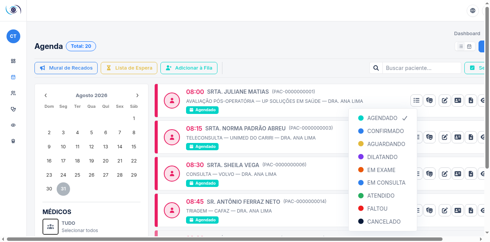

Fluxo típico do dia:

1. **Agendado** → paciente marcou.
2. **Confirmado** → paciente confirmou presença (por telefone/WhatsApp).
3. **Aguardando** → paciente chegou à recepção.
4. **Dilatando / Em exame / Em consulta** → etapas clínicas.
5. **Atendido** → consulta concluída.
6. **Faltou** → paciente não compareceu.
7. **Cancelado** → consulta cancelada (o sistema pede o **motivo** do cancelamento).

> Ao escolher **Cancelado**, uma janela pede o motivo — descreva-o e confirme.
> O horário volta a ficar livre para novos agendamentos.

Os demais botões do card permitem **editar** o agendamento, **reagendar** para outro
horário e abrir os dados do paciente. O botão **Reagendar** também permite
[reagendar a série de sessões](#reagendar-a-série-de-sessões).

### Drawer de detalhe: códigos e cadastro do paciente

O ícone **Visualizar** (olho) do card abre o detalhe completo do agendamento:

Os campos **Código** (do agendamento, do paciente e do médico) têm um botão de **copiar**
ao lado — útil para colar em mensagens, planilhas ou no prontuário sem digitar manualmente.
Um ✓ verde confirma a cópia:

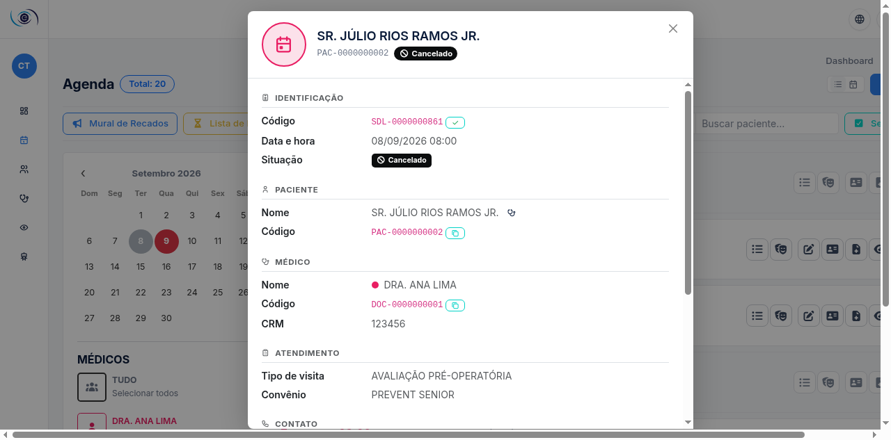

O ícone **Cadastro do paciente** (no card, fora do drawer) leva direto à ficha do paciente
**já com o cadastro aberto para edição** — não é preciso buscar o paciente de novo na
lista de Pacientes.

### Série de sessões no detalhe do agendamento

Quando o agendamento faz parte de uma série, o detalhe mostra a seção **Série de sessões**, com
todas as sessões e a situação de cada uma. O rótulo "3/10" quer dizer sessão 3 de 10.

- **Cancelar as futuras (N)** — pede o **Motivo do cancelamento** e cancela só as sessões que ainda
  não aconteceram (Agendado ou Confirmado). Sessões passadas, atendidas ou em andamento ficam como estão.
- **Acrescentar sessão** — aparece só na **série aberta**, explicada a seguir.

**Série aberta.** É uma série **sem total**: não se sabe quantas sessões terá, porque o médico decide o
intervalo a cada visita (o "trate e estenda" das injeções intravítreas). Ela nasce quando o médico
agenda a próxima aplicação de um tratamento com injeções
([Manual do Médico](../medico/README.md#tratamento-com-injeções-intravítreas-anti-vegf)).
Na agenda, a sessão aparece só com o número ("3"), sem "/total".

Para marcar a próxima sessão de uma série aberta:

1. No detalhe do agendamento, em **Série de sessões**, clique em **Acrescentar sessão**.
2. Informe a **Data e hora da nova sessão** (precisa ser no futuro).
3. Clique em **Acrescentar**. O sistema avisa "Sessão acrescentada à série."

A nova sessão copia médico, paciente, convênio, sala e encaixe do agendamento e segue a mesma regra do
agendamento comum (médico, intervalo entre consultas, bloqueio e sala). Se o horário não couber, o
sistema mostra o motivo e não grava nada.

> Série **fechada** (criada em **Repetir**, com total) não aceita sessão extra:
> "Só se acrescenta sessão a uma série aberta (sem total)."

### Reagendar a série de sessões

Para mudar o horário, abra o detalhe do agendamento e clique em **Reagendar** na sessão desejada. Você também pode usar o botão **Reagendar** do card, na agenda do dia.

Escolha quais sessões mudar:

- **Só esta sessão**: muda apenas a sessão escolhida.
- **Esta e as seguintes (N)**: desloca a sessão escolhida e as futuras a partir dela pelo mesmo intervalo. As anteriores, mesmo futuras, ficam como estão. Sessões passadas, atendidas, em andamento, canceladas e faltas também ficam como estão.

Se você trocar o **médico** ou marcar/desmarcar **encaixe**, a escolha vale para todas as sessões afetadas. Sem trocar, cada sessão mantém o que já tinha.

Ao escolher a série, confira a **prévia** com a data antiga, a data nova e os conflitos de cada sessão. A prévia verifica médico, escala, bloqueio, sala e teto de encaixe. Se qualquer sessão não couber, a confirmação fica bloqueada e nada é gravado. Ajuste o horário e confira a nova prévia antes de confirmar.

A numeração (como “3/10”) e o total da série são preservados. As sessões antigas aparecem como **Cancelado**, com a nota “Reagendado para …”.

> A remarcação da série não envia aviso automático ao paciente; combine o novo horário na recepção.

---

## 5. Mural de recados

Comunicação interna da equipe, direto na Agenda. Clique em **Mural de Recados**:

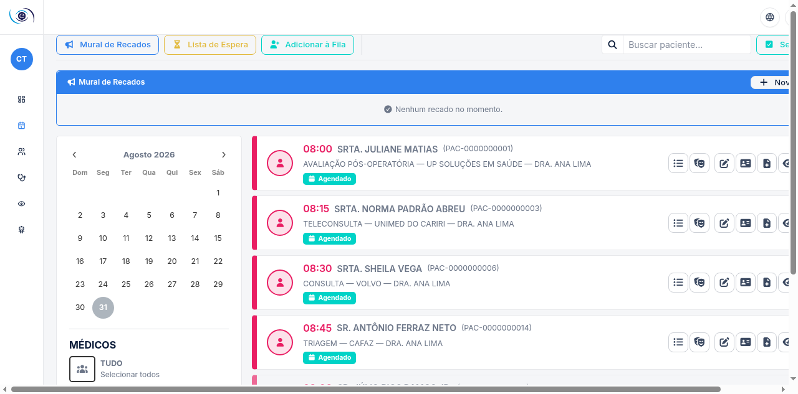

Para publicar um recado:

1. Clique em **Novo** (botão com "+" no cabeçalho azul do mural).
2. Digite o recado (até 1000 caracteres).
3. Opcional: marque **Urgente** (o recado ganha destaque) e defina **Expira em** (data em que
   o recado some sozinho).
4. Clique em **Publicar**.

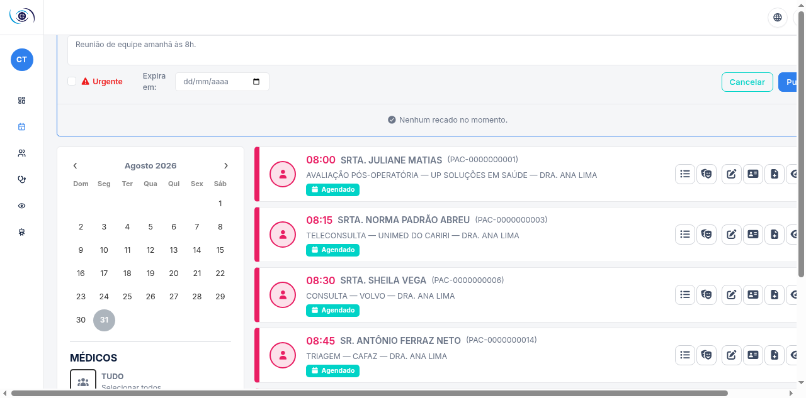

- **Li** — marca o recado como lido (check verde para a equipe saber quem viu).
- **×** — exclui um recado seu.

---

## 6. Fila de espera

Para pacientes que querem consulta, mas não há horário disponível.

### Adicionar à fila

1. Na Agenda, clique em **Adicionar à Fila**.
2. Preencha o painel:

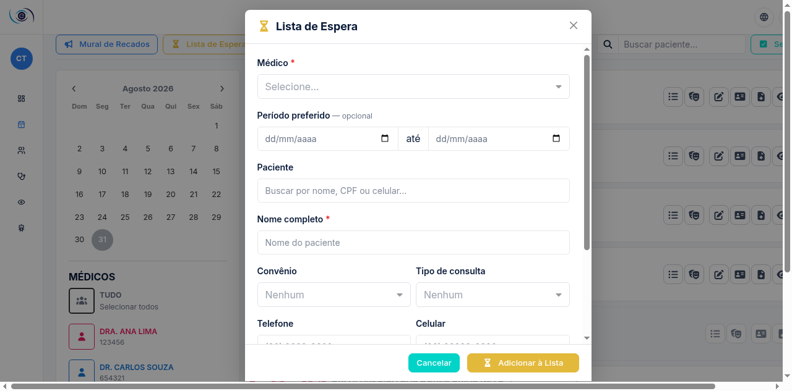

   - **Médico** (obrigatório) — fila é por profissional.
   - **Período preferido** — datas em que o paciente pode vir.
   - **Paciente** — busque um cadastro existente ou informe o **nome completo**
     (com telefone/celular e a opção WhatsApp para contato).
   - **Observações** — motivo da consulta, urgência.
3. Clique em **Adicionar à Lista**.

### Gerenciar a fila

Clique em **Lista de Espera** para abrir o painel:

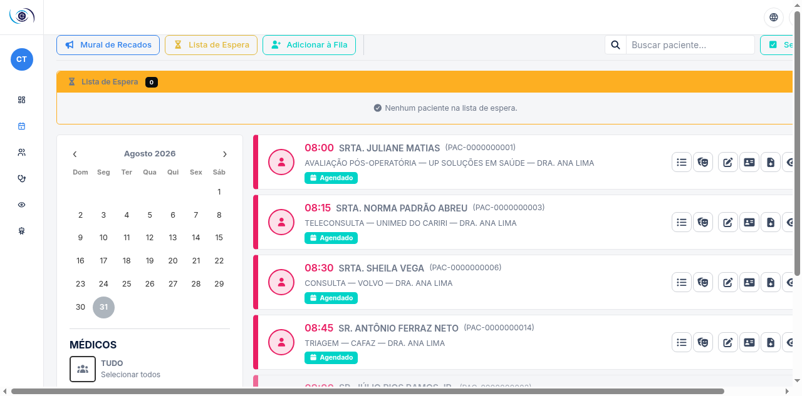

- As **setas ▲▼** mudam a ordem de prioridade.
- **Agendar** abre o novo agendamento já preenchido com os dados do paciente — use quando
  surgir um horário vago (por exemplo, após um cancelamento).
- **Remover** tira o paciente da fila.

---

## 7. Pacientes

Clique em **Pacientes** no menu:

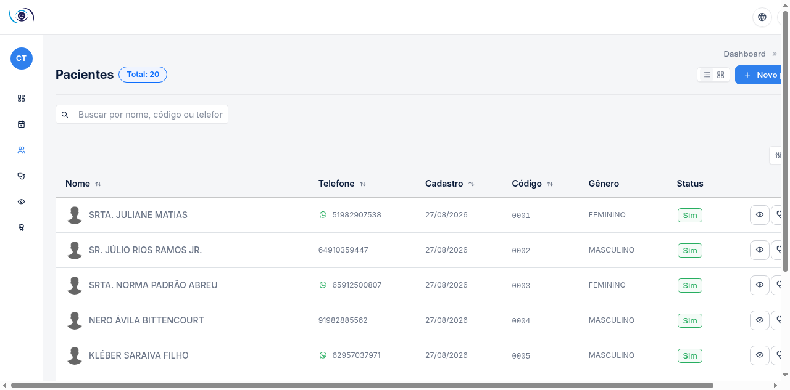

- **Busca** — por nome, código ou documento; a lista filtra automaticamente.
- Colunas personalizáveis pelo botão de engrenagem.
- Cada linha tem: **Visualizar** (olho), **Prontuário** (estetoscópio) e o menu **⋮**
  com Editar, Desativar e Excluir.

### Cadastrar um paciente

1. Clique em **Novo paciente**.
2. Preencha a aba **Pessoal** (nome completo é obrigatório; CPF, nascimento, gênero…):

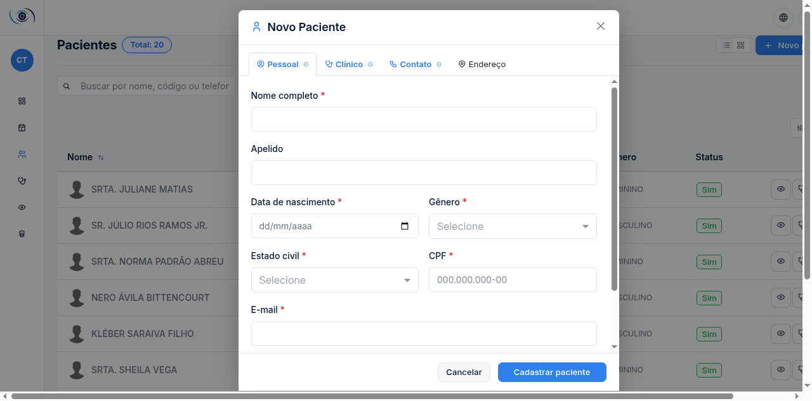

3. Na aba **Clínico**, informe o **convênio** do paciente e, se quiser, o **plano**:

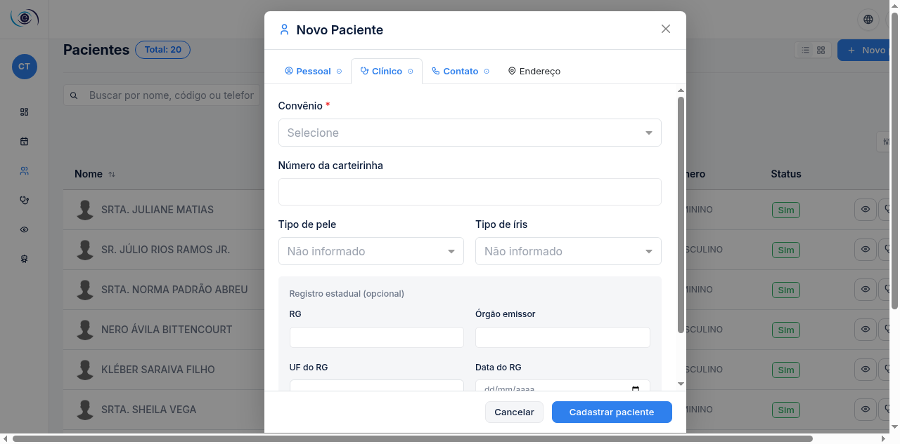

   - O campo **Plano** só abre depois do convênio. Ele já lista os primeiros planos do convênio;
     para achar um plano específico, digite parte do **nome** ou o **registro do produto na ANS**
     (número impresso na carteirinha). Abaixo do plano escolhido aparecem a contratação, a
     segmentação e se tem **coparticipação**.
   - Ao trocar o convênio, o plano é apagado (cada plano é de um convênio). **Particular** não
     tem plano nem carteirinha.
   - Se o plano do paciente foi cancelado na ANS, o cadastro avisa — escolha o plano novo da
     carteirinha quando o paciente trouxer.
   - Não achou o plano? Peça ao administrador para cadastrar em **Configurações → Convênios →
     Planos**.

4. Preencha o contato (celular, e-mail, endereço — o **CEP preenche o endereço sozinho**).
   - Na aba **Contato**, marque **Este celular tem WhatsApp** se for o caso.
   - Se o paciente concordar em receber lembretes de retorno por WhatsApp, marque também
     **Autoriza lembretes de retorno por WhatsApp** (só habilita com o WhatsApp marcado). Sem essa
     autorização, o paciente nunca recebe o convite — veja a [seção 13](#13-convite-de-retorno-por-whatsapp).
5. Clique em **Salvar**.

### Consultar e editar

- O botão **Visualizar** abre o resumo do paciente:

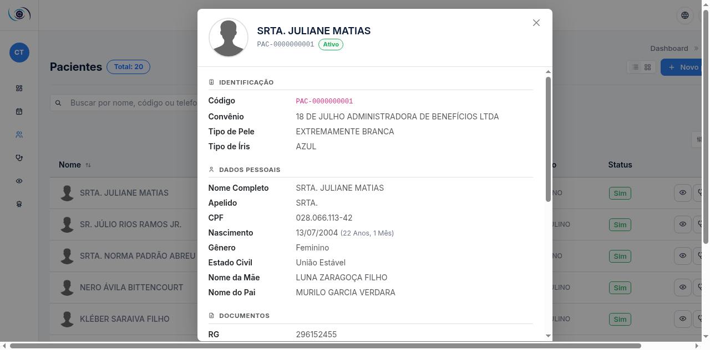

- Para alterar dados, use **⋮ → Editar**, mude o que precisar e salve.
- **Desativar** marca o paciente como inativo (badge "Não" na coluna Ativo) sem apagar nada;
  **Ativar** reverte.
- **Excluir** remove o paciente da operação (a linha fica marcada como Excluída) e
  **Restaurar** desfaz a exclusão. Nenhum histórico é perdido.

### Prontuário (leitura)

O botão **Prontuário** abre o histórico clínico do paciente. O perfil de secretária
**visualiza** os prontuários; criação e edição são exclusivas do médico.

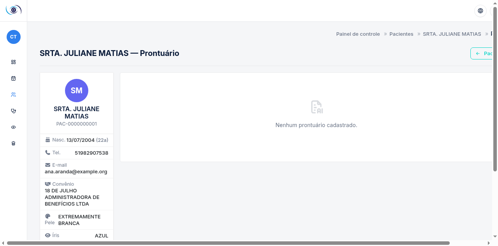

---

## 8. Importação de pacientes por planilha

Para migrar cadastros de outro sistema. Menu **Pacientes → Importar** (ou `/panel/patients/import`):

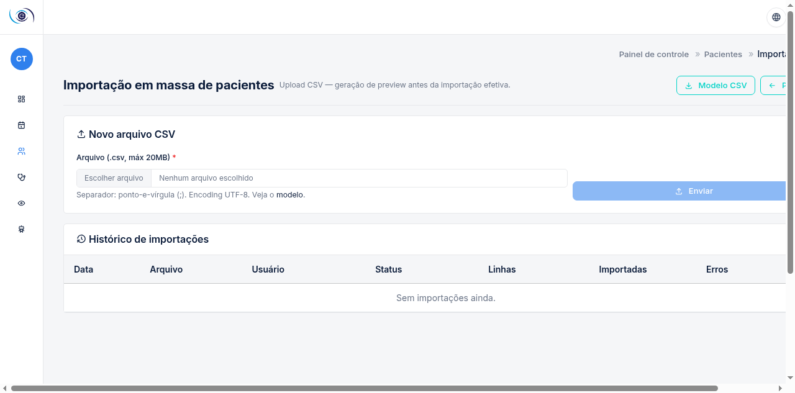

1. Clique em **Baixar modelo** e preencha a planilha (CSV) com os pacientes.
2. Envie o arquivo na área de upload.
3. O sistema mostra a **prévia**: quantos registros serão criados e os erros encontrados
   (linhas com problema não são importadas).
4. Revise e clique em **Confirmar** para efetivar — ou **Cancelar** para descartar tudo
   (nada é gravado até a confirmação).

---

## 9. Médicos: consulta, escala e bloqueios

Clique em **Médicos** no menu:

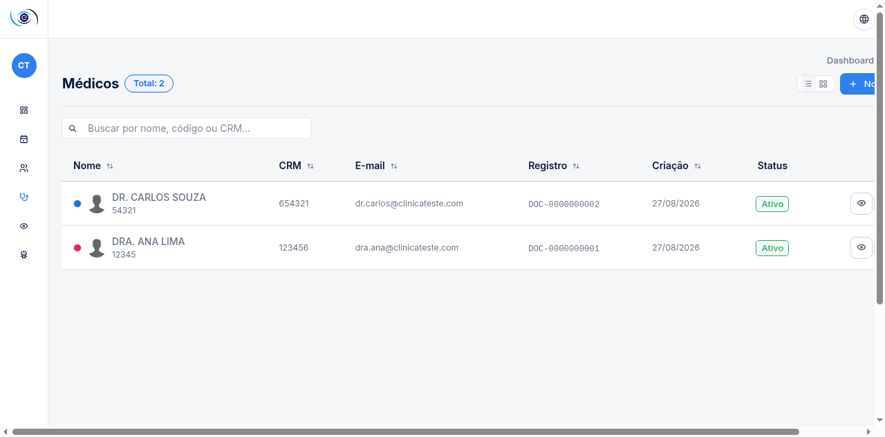

O perfil de secretária **consulta** o corpo clínico e **administra a agenda** dos médicos.
O cadastro de novos médicos é exclusivo do administrador (cria credencial de acesso).

### Escala de atendimento

Na linha do médico, clique no ícone **Horários de atendimento**:

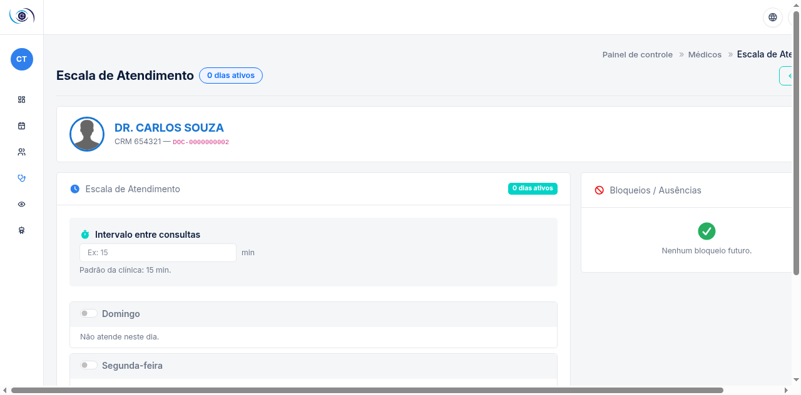

1. **Intervalo entre consultas** — duração padrão de cada atendimento (ex.: 15 min).
2. Ative os **dias da semana** em que o médico atende e defina as **faixas de horário**
   (ex.: 07:00–12:00 e 14:00–18:00). Use **+ Faixa** para períodos adicionais no mesmo dia.
3. Clique em **Salvar Escala**.

A escala alimenta os horários oferecidos no novo agendamento.

### Bloqueios e ausências

No cartão **Bloqueios / Ausências** (mesma tela):

1. Clique no **+** para abrir o formulário.
2. Escolha o **tipo** (Ausência, Feriado, Reunião/Compromisso, Outro), o período
   (início e fim) e um motivo opcional.
3. Clique em **Adicionar Bloqueio**.

Durante um bloqueio o médico não recebe agendamentos. A lixeira remove um bloqueio futuro.

---

## 10. Gerenciador de exames

Menu **Gerenciador de exames** — central de exames de imagem dos pacientes:

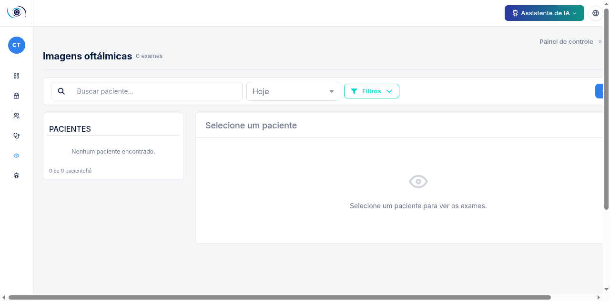

- Busque o paciente na coluna esquerda para ver os exames dele.
- **Filtros** refina por olho (OD/OE/AO), tipo de exame, equipamento, médico e período.
- **Novo** importa um exame externo (arquivo trazido pelo paciente): selecione o paciente,
  o tipo de exame, a data e anexe os arquivos (JPG, PNG ou PDF). Dá para misturar arquivos
  anexados e fotos/vídeos da câmera no mesmo lote: o sistema guarda a origem de **cada**
  arquivo — só o que foi capturado pela câmera conta como produção da clínica no repasse
  médico; os arquivos anexados continuam sendo exame externo.

### Comparar exames

Selecione o paciente e marque **2 exames** nas miniaturas — o botão **Comparar** só
habilita com essa seleção. O modal compara em **Sobrepor** (opacidade ajustável, arraste
para alinhar) ou **Lado a lado**:

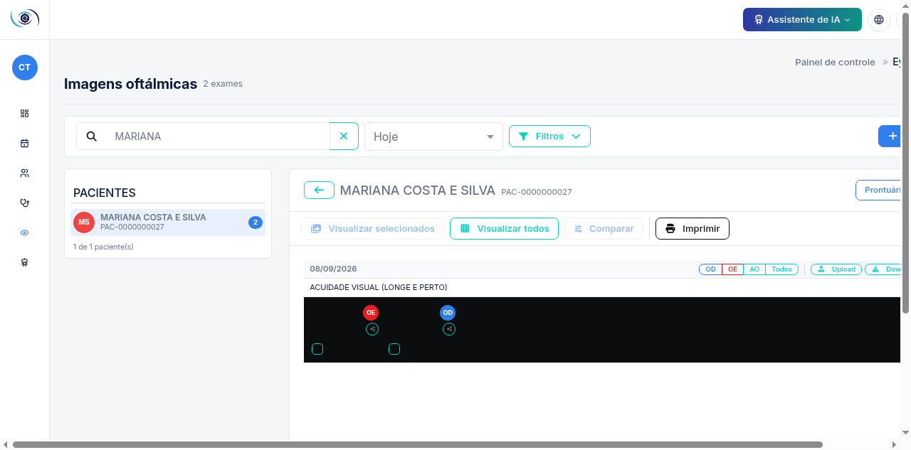

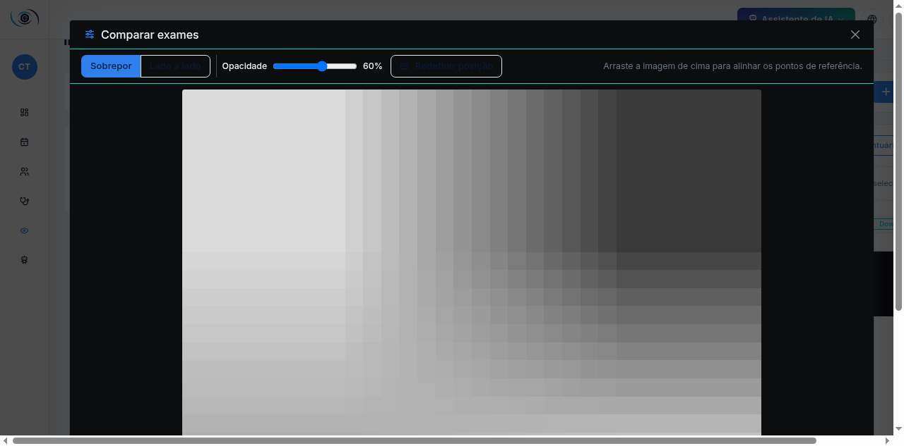

> **Novo laudo** (emitir laudo do exame) é ato médico exclusivo — não aparece pra
> secretária, mesmo com acesso total ao restante do módulo.

### Preparar, corrigir e reenviar rascunhos de laudo

Depois de selecionar o paciente e os exames, clique em **Preparar rascunho**. Preencha
o conteúdo e use **Enviar para o médico** quando ele estiver pronto para revisão. O
botão **Rascunhos** no topo reúne os itens da clínica. Se um médico devolver um deles,
o selo amarelo mostra a quantidade pendente e o filtro **Devolvido ao técnico** encontra
esses itens rapidamente.

Abra o rascunho devolvido, leia o aviso no topo com o motivo informado pelo médico,
faça a correção e escolha **Reenviar para o médico**. O reenvio remove o motivo da tela
e devolve o item à fila de revisão; a secretária não emite o laudo final.

O ditado vem **desligado de fábrica** (`AI_TRANSCRIPTION_ENABLED`). Quando a plataforma
EasyEye o habilita no **Manager**, o editor mostra o botão **Ditar**, que grava a fala e
insere a transcrição no cursor. O áudio é enviado a um provedor de IA aprovado para virar
texto e não fica guardado no EasyEye. Se o botão não aparecer, peça essa habilitação ao
suporte EasyEye. Não cite nome, CPF, telefone ou outro identificador do paciente; revise
o texto transcrito antes de salvar ou reenviar.

### Imprimir exames por folha

Com o paciente selecionado, clique em **Imprimir**. Em **Por folha**, escolha **1**,
**2**, **4** ou **6** imagens para organizar páginas A4 separadas. Ajuste **Retrato** ou
**Paisagem**, confira a prévia e clique em **Imprimir**. Vídeos não aparecem no papel;
abra-os no painel quando precisar assisti-los.

---

## 11. Portal do Paciente: convite e compartilhamento de exame

O **Portal do Paciente** dá ao paciente um login próprio (fora do `/panel`) para consultar
laudos e exames que a clínica compartilhar com ele. O passo a passo completo da experiência
do paciente está no [Manual do Portal do Paciente](../manual-portal-paciente/README.md).

### Enviar convite de acesso

Na ficha do paciente (**Pacientes → ícone de visualizar**), role até **Portal do
Paciente** e clique em **Convidar para o portal**. O sistema envia um e-mail com um
link de criação de login único:

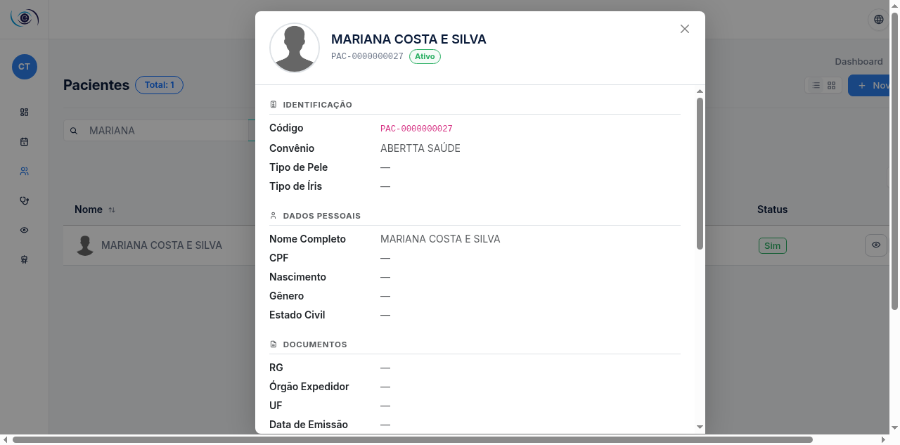

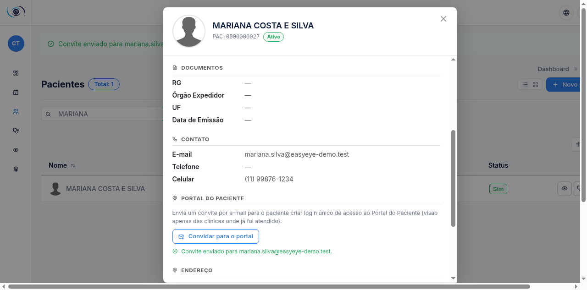

O botão fica indisponível se o paciente não tiver e-mail cadastrado ou já tiver conta
ativa no portal. Reenviar é seguro — não cria uma segunda conta.

### Compartilhar exame de imagem

No Gerenciador de exames, cada miniatura tem um selo circular de compartilhamento.
Clique para liberar o exame ao paciente pelo portal; clicar de novo revoga o acesso:

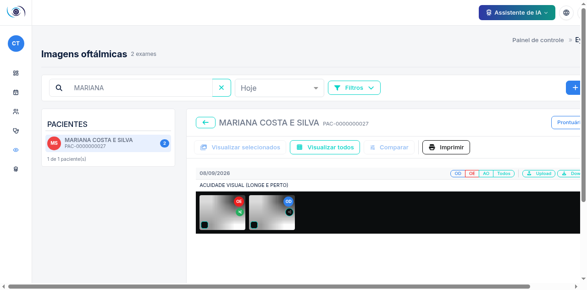

> **Laudo do prontuário** (conteúdo clínico assinado) você **não pode** compartilhar —
> é permitido só a Administrador e Médico (decisão de produto). O ícone de
> compartilhamento pode até aparecer no drawer do prontuário, mas a ação retorna erro;
> use o compartilhamento de **exame**, que é liberado pra secretária.

---

## 12. Retornos: quem precisa voltar à clínica

O menu **Retornos** lista os pacientes que já deveriam voltar à clínica — para uma consulta, um exame
ou a próxima aplicação de um tratamento. O seu trabalho é **contatar**, **agendar**, **adiar** ou
**dispensar** cada retorno.

> **Plano da clínica**: o item **Retornos** só aparece se o plano inclui o recurso *Retorno de
> pacientes crônicos (recall)*. Não está no seu menu? Peça ao administrador para conferir o plano em
> **Minha assinatura**.

### De onde vêm os retornos

| Origem (filtro **Origem**) | O que gera o retorno |
|---|---|
| Retorno pedido pelo médico | O campo **Retorno em … dias** do prontuário, contado a partir do último atendimento do paciente. Vale para qualquer paciente. O administrador ou o médico pode desligar em **Retornos → Configurar**. |
| Acompanhamento de condição | Um protocolo de acompanhamento (por exemplo, glaucoma ou DMRI) que um **médico ativou** para a clínica, para pacientes com a condição ativa. Só existem protocolos **validados** por um oftalmologista revisor externo e liberados pelo EasyEye. Protocolo que ninguém ativou não gera retorno. |
| Aplicações do tratamento | A próxima aplicação de um tratamento com injeções intravítreas (anti-VEGF), na data que o médico decidiu. |

Enquanto a clínica não tiver nenhuma dessas origens, a tela mostra **Nenhum retorno ainda**. Não é erro.

### Visões da lista

Os quatro cartões do topo são atalhos para as visões da lista. O número é da clínica inteira.

| Visão | O que mostra |
|---|---|
| **Para contatar** | Retornos em aberto, sem agendamento, que já entraram no prazo de aviso. O cartão mostra "N a vencer · N vencidos". É a visão que abre por padrão. |
| **Perdidos de vista** | Retornos muito atrasados e sem agendamento. É a lista da busca ativa por telefone. |
| **Agendados** | Retornos em aberto que já têm um agendamento ligado. |
| **Adiados** | Retornos que alguém adiou. Voltam sozinhos para **Para contatar** na data escolhida. |

Três botões aparecem abaixo dos cartões:

- **Histórico** — retornos dispensados ou encerrados nos últimos 90 dias, com o motivo
  ("Dispensado: …" ou "Encerrado: …"). Motivos de encerramento: Concluído, Condição encerrada,
  Protocolo desativado, Tarefa desligada, Sem retorno pedido, Retorno pedido pelo médico desligado,
  Feito em outro serviço, Paciente removido, Tratamento encerrado ou pausado.
- **Falta informação (N)** — só aparece quando há casos. O retorno não pode ser calculado porque falta
  a data de início do acompanhamento: "O médico preenche na ficha do paciente". Você não age aqui.
- **Regra suspensa (N)** — só aparece quando há casos. O EasyEye suspendeu a regra do protocolo, e
  os retornos ficam parados até ela voltar: "Nenhuma ação enquanto durar a suspensão". Eles voltam
  sozinhos quando a regra é retomada.

Filtros: **Buscar paciente** (nome ou código), **Origem** (Todas, Retorno pedido pelo médico,
Acompanhamento de condição, Aplicações do tratamento) e **Limpar filtros**.

### O que cada linha mostra

| Coluna | Conteúdo |
|---|---|
| Paciente | Nome, idade, celular (com o ícone de WhatsApp quando o celular está marcado) e, se houver, o aviso **Não ligue/envie: motivo** (óbito, pediu para não ser contatado, mudou de cidade, sem telefone válido ou outro motivo). |
| O que falta | O que o paciente precisa fazer: "Retorno pedido pelo médico", "Consulta de retorno", "Exame: Campo visual (campimetria)", "Próxima aplicação do tratamento". Mostra também a data do último registro ("Sem registro neste acompanhamento", se não houver). |
| Vencimento | A data, "Vence hoje", "Vence em N dias" ou "Venceu há N dias", e a etiqueta do estado do prazo. |
| Contato | "Sem contato ainda" ou "N contatos — último resultado · data"; "Agendado para …", "Adiado até …", "Dispensado: …"; e a situação do convite por WhatsApp ([seção 13](#13-convite-de-retorno-por-whatsapp)). |
| Ações | Os botões da linha (veja abaixo). |

> **Minimização**: você vê **o que falta** ("Consulta de retorno"), não o diagnóstico. A condição
> ("Condição: …") aparece só para o médico. Se uma linha trouxer **Prazo limitado ao máximo validado
> para a condição**, o médico pediu um retorno mais longo do que o protocolo valida, e a lista usa o
> máximo.

### Estados do prazo

O estado sai das datas e muda sozinho, sem ninguém mexer:

| Estado | Quando | Aparece na lista? |
|---|---|---|
| Em dia | Ainda falta mais que o período de aviso. | Não |
| A vencer | Entrou no período de aviso. Já dá para contatar e convidar. | Sim, em **Para contatar** |
| Vencido | Passou do dia do vencimento, dentro da tolerância. | Sim, em **Para contatar** |
| Em atraso | Passou da tolerância. | Sim, em **Para contatar** |
| Perdido de vista | Atraso muito grande. Não recebe convite por WhatsApp: só ligação. | Sim, em **Perdidos de vista** |

Os prazos dependem da origem:

| Origem | A vencer (aviso) | Vencido (tolerância) | Perdido de vista |
|---|---|---|---|
| Retorno pedido pelo médico | 30 dias antes do vencimento | até 30 dias depois | mais de 180 dias depois |
| Próxima aplicação do tratamento | 14 dias antes | até 7 dias depois | mais de 90 dias depois |
| Acompanhamento de condição | Prazos definidos pela regra do protocolo (o médico vê em **Retornos → Configurar → Ver a regra**) | | |

Passada a tolerância, o retorno fica **Em atraso** até virar **Perdido de vista**.

### O que fazer com cada retorno

Os botões aparecem só para retornos em aberto ou adiados e sem regra suspensa.

**Contatar** — registra a tentativa de contato:

1. Clique em **Contatar**.
2. Em **Como foi o contato?**, escolha: *Falei com o paciente*, *Vai agendar*, *Não atendeu*,
   *Número errado ou fora de serviço* ou *Não quer voltar*.
3. Se quiser, escreva uma **Observação** (até 200 caracteres). Não escreva diagnóstico nem dado de
   saúde aqui.
4. Clique em **Registrar contato**.

O resultado é só um registro: ele conta o contato e guarda o último resultado, mas não muda o prazo
nem fecha o retorno.

**Agendar** — marca o retorno sem digitar o paciente de novo:

1. Clique em **Agendar**. A Agenda abre com o novo agendamento já preenchido com o paciente, e a faixa
   "Agendando o retorno: …" mostra qual retorno você está atendendo.
2. Escolha médico e horário como na [seção 3](#3-novo-agendamento) e clique em **Salvar e vincular**.
3. O retorno passa para **Agendados**. O botão **Agendar** some das linhas que já têm agendamento.

Se você marcar pela Agenda sem usar o botão **Agendar**, o sistema liga o próximo agendamento
aberto do paciente ao retorno em poucos minutos.

No retorno da **Próxima aplicação do tratamento** é diferente: o sistema só liga o horário da
própria aplicação (pelo botão **Agendar** ou pelo *Agendar a próxima* do médico). Uma consulta
marcada para o paciente, ou a injeção do outro olho, não tira esse retorno de **Para contatar**.

**Adiar** (menu **⋮ Mais ações**) — só para retorno em aberto:

1. Em **Adiar até**, escolha uma data de amanhã até 365 dias à frente.
2. Se quiser, preencha o **Motivo**.
3. Clique em **Adiar**. O retorno volta sozinho para a lista nessa data.

**Já fez fora** (menu **⋮ Mais ações**) — o paciente já fez a consulta ou o exame em outro serviço:

1. Informe a **Data em que foi feito** (não pode ser futura nem anterior ao início do acompanhamento).
2. Clique em **Registrar**. A data entra no cálculo do próximo vencimento, como se o ato tivesse sido
   feito na clínica.

Essa ação não existe para a **Próxima aplicação do tratamento**: quem registra a aplicação e decide
o novo intervalo é o médico.

**Dispensar** (menu **⋮ Mais ações**) — o paciente não precisa ou não vai voltar:

1. Escreva o **Motivo** (obrigatório, até 200 caracteres).
2. Clique em **Dispensar**. O retorno sai da lista até o paciente voltar à clínica e vai para o **Histórico**.

**Reabrir** — desfaz um adiamento ou uma dispensa. Clique em **Reabrir** na linha (visões **Adiados**
e **Histórico**) e confirme. O retorno volta para **Para contatar**.

**Enviar convite** — manda o convite por WhatsApp. Veja a [seção 13](#13-convite-de-retorno-por-whatsapp).

Se outra pessoa tratar o mesmo retorno antes de você, o sistema avisa "Este retorno mudou: outra
pessoa já tratou. A lista foi atualizada." Cada ação fica registrada com o seu nome.

### Quando o retorno muda sozinho

- **Paciente atendido**: o novo atendimento registrado em prontuário recalcula o prazo a partir da
  consulta (novo ciclo).
- **Exame feito na clínica**: se o tipo do exame estiver ligado ao exame do protocolo (**Retornos →
  Configurar → Exames**), o exame registrado adia o próximo retorno daquele exame.
- **Agendamento**: o retorno vai para **Agendados**.
- **Protocolo desativado, condição encerrada ou retorno pedido pelo médico desligado**: o retorno é
  encerrado e vai para o **Histórico**.

### O que você não faz em Retornos

- **Ativar ou desativar protocolos**: é ato do médico. Em **Retornos → Configurar** você só consulta
  a regra e quem a validou.
- **Alterar a configuração** (retorno pedido pelo médico, convite por WhatsApp, exames): é do
  administrador ou do médico. Na tela de configuração, os campos aparecem bloqueados para você.
- **Ver ou decidir a condição clínica** do paciente: é do médico.
- **Registrar a aplicação** de uma injeção intravítrea ou **encerrar o tratamento**: é do médico.

---

## 13. Convite de retorno por WhatsApp

O convite lembra o paciente de **voltar** à clínica. Ele nunca diz **por quê**: a mensagem leva só o
primeiro nome do paciente e o nome da clínica.

> Olá, [primeiro nome]! A [clínica] lembra que chegou a hora de agendar o seu retorno de
> acompanhamento. Para marcar, toque em Quero agendar ou fale com a clínica.
> Para não receber mais avisos, responda SAIR.
> Botões: **Quero agendar** · **Já agendei**

### O que precisa estar certo

| Quem | O quê |
|---|---|
| Plano | O recurso de retornos está no plano da clínica. |
| EasyEye | O EasyEye liberou o convite para a clínica, o WhatsApp da clínica (número do EasyEye ou próprio) está ativo e a assinatura está em dia. Isso você não ajusta: peça ao administrador para falar com o EasyEye. |
| Clínica | A chave **Enviar convites de retorno por WhatsApp** está ligada em **Retornos → Configurar** (administrador ou médico). Ela nasce **desligada**. |
| Paciente | O celular está marcado como WhatsApp e o paciente **autorizou** os lembretes de retorno. |

### Registrar a autorização do paciente

O consentimento chama-se **Lembretes de retorno por WhatsApp** e é coletado no cadastro:

1. Abra o cadastro do paciente (**Pacientes → ⋮ → Editar**) e vá para a aba **Contato**.
2. Marque **Este celular tem WhatsApp**.
3. Se o paciente concordar, marque **Autoriza lembretes de retorno por WhatsApp**. O texto de apoio
   avisa: "O lembrete não cita o motivo do acompanhamento. O paciente pode parar a qualquer momento
   respondendo SAIR."
4. Clique em **Salvar**.

- Marcar registra o consentimento com o seu nome, o canal presencial e a data. Desmarcar revoga a
  autorização (motivo "Desmarcado no cadastro do paciente").
- Na ficha do paciente (**Visualizar**), a etiqueta **Lembretes de retorno** mostra que a autorização
  está vigente. A etiqueta **Descadastrado do WhatsApp** mostra que o celular respondeu SAIR.
- Pacientes importados por planilha ou por integração entram **sem** autorização. Marque no cadastro.
- Só marque se o paciente autorizou. Sem autorização, o paciente aparece em **Retornos**, mas só para
  ligação ("Sem autorização de WhatsApp — só ligação").

### Enviar o convite na mão

O botão **Enviar convite** aparece na linha quando o convite pode, em princípio, sair: retorno em
aberto, canal da clínica aberto, paciente com WhatsApp e autorização, sem SAIR e sem bloqueio de contato.

1. Clique em **Enviar convite**. A janela **Convidar por WhatsApp** confere o convite e mostra:
   - **Para:** o celular do paciente, parcialmente escondido, e quantos retornos o convite cobre
     (um convite cobre todos os retornos do paciente que podem ser convidados hoje);
   - **Mensagem que o paciente vai receber** e os **Botões da mensagem**;
   - o ritmo: "Hoje: N de N convites da clínica", "Último convite: data" e, se for o caso,
     "Novo convite só a partir de data".
2. Se houver impedimento, a janela mostra "Este convite não pode sair agora:" com a lista de motivos
   (tabela abaixo) e o botão fica desabilitado. Registre o contato por telefone em **Contatar**.
3. Sem impedimento, clique em **Enviar convite**. O sistema avisa "Convite enviado para a fila do
   WhatsApp."

O envio manual não depende da janela de horário. Vale o intervalo mínimo entre convites, o limite
diário da clínica e **um convite por paciente por dia**.

### Acompanhar na lista

A linha mostra o que aconteceu com o último convite e se foi "(automático)" ou "(enviado pela equipe)":

| Aparece | Significa |
|---|---|
| Convite por WhatsApp na fila | Ainda não saiu. |
| Convite por WhatsApp enviado em … | Saiu. |
| Convite entregue em … / Convite lido em … | O WhatsApp confirmou a entrega e a leitura. |
| O convite por WhatsApp não foi entregue | Falhou. Ligue para o paciente. |
| Convite cancelado antes de sair | Algo mudou antes do envio (autorização retirada, SAIR, retorno já tratado, pausa). É o comportamento esperado. |
| **Pediu para agendar** | O paciente tocou em **Quero agendar** (vale por 30 dias). A linha sobe para o topo da lista: ele já pediu, só falta você marcar. |
| **Disse que já agendou em … — confira a agenda** | O paciente tocou em **Já agendei**. Confira se há agendamento. |

O sistema **não agenda sozinho**. O botão **Quero agendar** só avisa a recepção.

### Quando o convite não sai

| Motivo na janela | O que significa e o que fazer |
|---|---|
| Os convites estão pausados pelo EasyEye. | Pausa geral do EasyEye. Contate por telefone e aguarde. |
| O EasyEye ainda não liberou o convite por WhatsApp para esta clínica. | Peça ao administrador para falar com o EasyEye. |
| O WhatsApp da clínica não está ativo (número do EasyEye ou próprio). | Idem. |
| O acesso da clínica está bloqueado (assinatura): nenhuma mensagem automática sai. | O administrador precisa regularizar a assinatura. |
| O convite por WhatsApp está desligado nas configurações dos retornos. | O administrador ou o médico liga a chave em **Retornos → Configurar**. |
| O paciente está inativo ou foi removido. | Reative o cadastro, se for o caso. |
| O paciente está marcado como "não contatar". | Não insista. |
| O paciente não autorizou lembretes de retorno por WhatsApp. | Registre a autorização no cadastro, se o paciente concordar. Senão, ligue. |
| O celular do paciente não está marcado como WhatsApp. | Corrija o cadastro, se o celular tiver WhatsApp. |
| O celular do paciente não é válido para WhatsApp. | Corrija o celular (DDD e número de celular). |
| O paciente respondeu SAIR e não quer receber mensagens por este número. | Só ligação. Veja SAIR abaixo. |
| Não há retorno a convidar: foi agendado, adiado, dispensado ou a regra não está em uso. | Confira a linha. Retorno **Perdido de vista** também não recebe convite. |
| Fora da janela de horário dos convites. | Vale só para o envio automático. |
| O paciente recebeu um convite há pouco tempo. | Aguarde a data de "Novo convite só a partir de". Ligue, se for urgente. |
| O limite diário de convites da clínica foi atingido. | Tente amanhã. |

### SAIR e VOLTAR

- Se o paciente responder **SAIR** (ou PARAR, STOP, DESCADASTRAR, UNSUBSCRIBE), o celular dele deixa de
  receber as mensagens automáticas daquele número de WhatsApp (confirmação de consulta, pesquisa e
  convite) e a **autorização de lembretes de retorno é retirada**.
- **VOLTAR** (ou ATIVAR, START) reativa o número, mas **não devolve a autorização**. Só um novo
  consentimento marcado no cadastro volta a liberar o convite.
- Para quem respondeu SAIR, o trabalho continua por **telefone**: a linha mostra
  "Respondeu SAIR — só ligação".

### Envio automático

O sistema também convida sozinho, de hora em hora, dentro da janela de horário e dos limites que o
administrador define em **Retornos → Configurar**. Você não configura o automático, mas vê o resultado
na linha ("(automático)"). Hoje o envio automático cobre o **Retorno pedido pelo médico** e a **Próxima
aplicação do tratamento**; os retornos de **Acompanhamento de condição** saem quando você usa **Enviar
convite**. Retorno atrasado demais deixa de receber convite automático e vai para a busca ativa por telefone.

---

## 14. Assistente de IA (consumo)

Menu **Assistente de IA** — acompanhamento do uso de inteligência artificial da clínica:

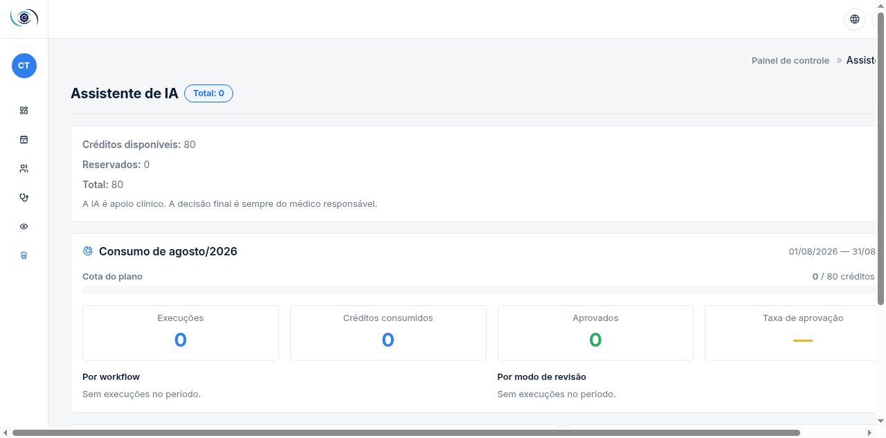

A secretária **acompanha** o consumo de créditos e o histórico de execuções.
A geração e aprovação de conteúdo clínico por IA é exclusiva dos médicos;
a compra de créditos é do administrador.

---

## 15. Avisos sobre a assinatura da clínica

Se o pagamento da assinatura do EasyEye atrasar, um aviso aparece no topo de todas as
telas. A secretária vê o aviso **sem valor nem link de pagamento**, com a orientação de
**procurar o administrador da clínica** — quem paga a assinatura é o administrador, o
financeiro ou o dono:

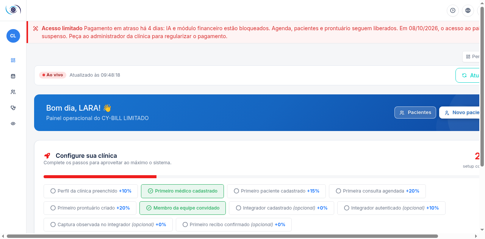

O que muda no seu dia a dia:

| Situação | O que acontece para a secretária |
|---|---|
| Pagamento em atraso (primeiros dias) | Só o aviso — tudo continua funcionando |
| **Acesso limitado** (3 dias de atraso) | **Agenda, pacientes, fila, mural, imagens e o "Lançar no caixa" do atendimento continuam funcionando.** Ficam bloqueados a inteligência artificial e o módulo financeiro |
| **Acesso suspenso** (7 dias de atraso) | O painel fica bloqueado: qualquer tela mostra a página abaixo, até o pagamento ser confirmado |

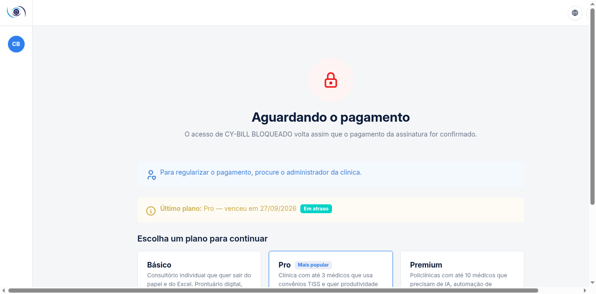

Com o acesso suspenso, também ficam pausadas as **mensagens automáticas de WhatsApp** aos
pacientes (confirmação de consulta, pesquisa e convite de retorno) e a **TV do painel de chamadas** mostra
"Serviço indisponível". Tudo volta sozinho quando o pagamento é confirmado — avise o
administrador assim que perceber o aviso, para não chegar a essa etapa.

---

## 16. Minha conta e saída do sistema

### Meu perfil

Clique no seu avatar (canto superior direito) → **Editar perfil**:

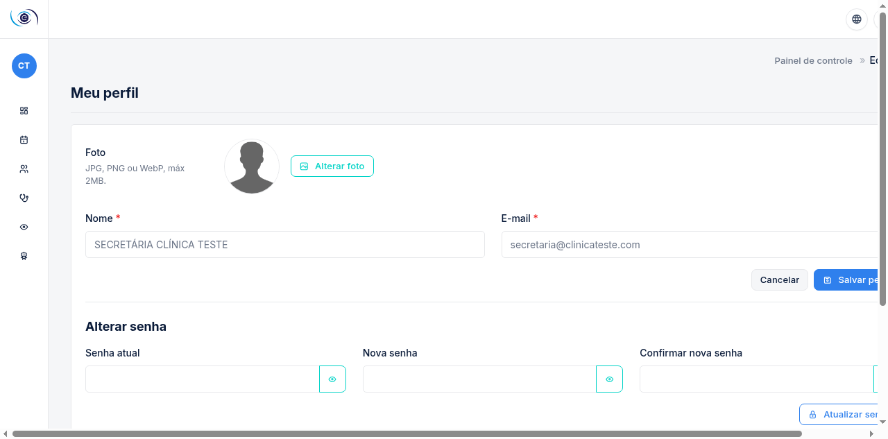

- Altere **nome**, **e-mail** e **foto**.
- Na seção **Alterar senha**, informe a senha atual e a nova senha
  (mínimo 8 caracteres com maiúsculas, minúsculas, números e símbolos).
- Em **Autenticação em dois fatores**, configure seu aplicativo autenticador
  (Google/Microsoft Authenticator) — recomendado.

### Sair

Avatar → **Sair**:

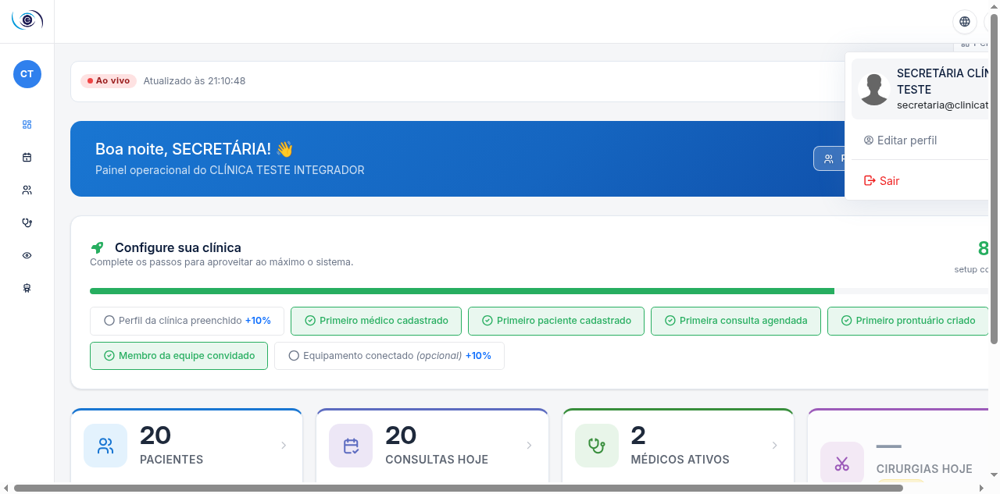

---

## 17. O que o perfil de secretária NÃO acessa

Por segurança e conformidade (LGPD/CFM), estas áreas retornam **acesso negado** para o
perfil de secretária:

| Área | Motivo | Quem acessa |
|---|---|---|
| Financeiro (caixa, faturamento, TISS) | Dados financeiros | Administrador e Financeiro |
| Relatórios e Compliance | Dados gerenciais e trilhas de auditoria | Administrador |
| Controle de acesso (usuários e perfis) | Gestão de credenciais | Administrador |
| Configurações da clínica (catálogos, convênios, salas) | Parametrização | Administrador |
| Cadastro/edição/exclusão de médicos | Cria credencial de login | Administrador |
| Criação e edição de prontuários | Ato médico | Médico |
| Emissão de laudo de imagem (Novo laudo) | Ato médico (CFM Res. 2.227/2018) | Médico |
| Compartilhar laudo com o paciente no Portal | Conteúdo clínico assinado | Administrador e Médico |
| Prompts de IA e aprovação de conteúdo IA | Responsabilidade clínica | Médico |
| Ativar ou desativar protocolos de retorno; ver e decidir as condições crônicas do paciente | Conduta clínica (a decisão grava o médico responsável) | Médico |
| Alterar a configuração dos retornos (retorno pedido pelo médico, convite por WhatsApp, exames) | Parametrização da clínica | Administrador e Médico |
| Injeção intravítrea (pedir, dar baixa, encerrar o tratamento) e emitir orientação pós-procedimento | Ato médico | Médico |
| Modelos de orientação pós-procedimento (Configurações) | Parametrização da clínica | Administrador |
| Painel do SaaS (`/panel/manager`) | Administração da plataforma | Equipe EasyEye |

Se precisar de algo nessas áreas, procure o administrador da clínica.

---

*Manual gerado a partir do EasyEye em produção de telas reais — perfil Secretária.
Dúvidas ou telas divergentes? A interface pode ter evoluído: gere novas capturas com o
comando indicado no topo deste documento.*
